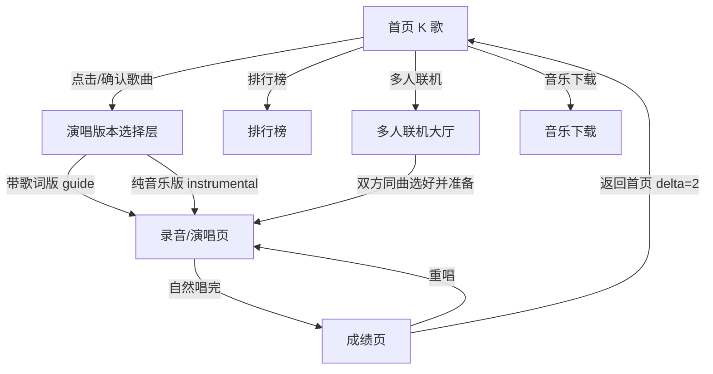

# K 歌完整工程说明

> 用途：把本项目完整交给其他开发者或大模型继续修改。
>
> 更新时间：2026-11-22
>
> 当前安装包：`H:\RokidAI\RokidAI\KROK\Karaoke.aix`

---

## 1. 项目概览

这是一个运行在 Rokid AIUI / InkView 上的 K 歌应用。

核心流程：

```text
打开应用
  -> 首页选歌
  -> 选择带歌词版 / 纯音乐版
  -> 录音页准备
  -> 三点倒数
  -> 播放伴奏、逐行提词、音高检测、ASR 识别
  -> 成绩页计算完整度与音准
  -> 保存本机成绩或提交排行榜
```

其他入口：

```text
排行榜
  -> 选择中文/英文/日语/韩语
  -> 选择分类内歌曲
  -> 查看服务器或本机排行榜

音乐下载
  -> 选择语言
  -> 选择歌曲
  -> 分片下载歌词版和纯音乐版
  -> 歌曲进入首页可播放曲库

多人联机
  -> 建立 WebSocket 连接
  -> 创建/加入房间
  -> 双方选择同一首歌
  -> 双方准备
  -> 服务端统一 3 秒同步倒计时
  -> 实时累计 0-100 分并同步对手分数
  -> 服务端结算
```

当前内置歌曲：

```text
사랑을 했다 (LOVE SCENARIO)
id: sarang-eul-haetda
歌手: iKON
分类: 한국어
标签: 练习
时长: 210653 ms
歌词: 47 行
参考旋律: 424 个音符
调性: G 大调
```

---

## 2. 运行平台与目录

### 2.1 平台

- UI 文件格式：Ink / AIUI。
- 页面使用 `<script setup>`、`<page>`、`<style>`。
- 页面数据通过 `setData()` 更新。
- 模板条件使用 `ink:if`、`ink:elif`、`ink:else`。
- 列表使用 `ink:for`、`ink:key`。
- 页面尺寸基准：内容区 `448 x 328`，外层额外 `margin: 12px 16px`，对应约 `480 x 352`。
- 主色调：`#4cc773`，通过 100/72/48/24/12 的透明度层级控制强弱。

### 2.2 客户端目录

```text
Karaoke/
├─ app.json
├─ app.js
├─ AGENTS.md
├─ assets/
│  └─ songs/
│     ├─ sarang-eul-haetda-guide.ogg
│     └─ sarang-eul-haetda-instrumental.ogg
├─ pages/
│  ├─ home/home.ink
│  ├─ record/record.ink
│  ├─ result/result.ink
│  ├─ leaderboard/leaderboard.ink
│  ├─ battle/battle.ink
│  └─ download/download.ink
├─ utils/
│  ├─ songData.js
│  ├─ sarangEulHaetdaSong.js
│  ├─ songLibrary.js
│  ├─ pitchEngine.js
│  ├─ scoreEngine.js
│  ├─ leaderboard.js
│  ├─ leaderboardConfig.js
│  ├─ battleClient.js
│  └─ battle.js
└─ tools/
   ├─ *-test.cjs
   └─ check-song-library.cjs
```

### 2.3 服务端目录

```text
karaoke-server/
├─ server.js
├─ catalog.json
├─ catalog-extra.json
├─ source/
├─ media/songs/
├─ melodies/
└─ data/karaoke.sqlite
```

线上部署路径：

```text
/www/karaoke-api/
```

---

## 3. 应用级声明

### 3.1 `app.json`

权限：

```json
["RECORD_AUDIO", "INTERNET"]
```

注册页面顺序：

```text
pages/home/home
pages/record/record
pages/result/result
pages/leaderboard/leaderboard
pages/battle/battle
pages/download/download
```

`pages/match` 目录为空，不属于当前工程。

### 3.2 `app.js`

启动时：

1. 调用 `preloadDefaultAudio()` 预热内置歌曲的歌词版和纯音乐版。
2. 应用回到前台时补传离线成绩。
3. 网络恢复时再次补传成绩。

方法：

| 方法 | 作用 |
|---|---|
| `preloadDefaultAudio()` | 预热 `songs[0]` 的两版音频 |
| `retryScores()` | 调用 `flushPendingScores()` |
| `onLaunch()` | 首次预热 |
| `onShow()` | 补传成绩、再次预热 |
| `onNetworkStatus(event)` | 在线时补传 |

---

## 4. 页面跳转关系



录音页 URL：

```text
/pages/record/record?songId=<id>&mode=guide
/pages/record/record?songId=<id>&mode=instrumental
```

联机录音页 URL：

```text
/pages/record/record
  ?mode=battle
  &songId=<id>
  &roomId=<roomId>
  &roundId=<roundId>
  &chartVersion=<n>
  &scoringVersion=<n>
  &selfId=<playerId>
  &opponent=<name>
```

成绩页 URL：

```text
/pages/result/result?songId=<id>&attemptId=<attemptId>
```

---

## 5. 通用数据结构

### 5.1 Song

```js
{
  id: "sarang-eul-haetda",
  name: "사랑을 했다 (LOVE SCENARIO)",
  artist: "iKON",
  album: "iKON",
  category: "한국어",
  tag: "练习",
  difficulty: 2,
  durationMs: 210653,
  chartVersion: 1,
  scoringVersion: 5,
  bundled: true,
  online: false,
  guideAccompaniment: "/assets/songs/sarang-eul-haetda-guide.ogg",
  instrumentalAccompaniment: "/assets/songs/sarang-eul-haetda-instrumental.ogg",
  accompaniment: "/assets/songs/sarang-eul-haetda-instrumental.ogg",
  estimatedKey: "G 大调",
  lyrics: [
    { text: "사랑을 했다 우리가 만나", startMs: 3200, endMs: 6800 }
  ],
  refNotes: [
    { midi: 55, startMs: 3200, endMs: 3440 }
  ]
}
```

### 5.2 录音记录

本地存储键：

```text
karaoke_last_recording
```

结构：

```js
{
  attemptId,
  songId,
  completed,
  chartVersion,
  scoringVersion,
  pitchTrack: [
    { timeMs, midi } // midi 可为 null
  ],
  recognizedText
}
```

### 5.3 音高帧

```js
{
  timeMs: 32020,
  midi: 59.4,
  voiceActive: true
}
```

上报服务端时压缩为：

```js
[frameIndex, midiOrNull, voiceActive ? 1 : 0]
```

`frameIndex = floor(timeMs / 40)`。

---

## 6. 首页 `pages/home/home.ink`

### 6.1 UI 层级

```text
page-root 448x328
├─ main-view，choiceVisible=false 时才渲染
│  ├─ topbar 36px
│  │  └─ "K 歌"
│  ├─ song-list，弹性剩余高度，纵向滚动
│  │  └─ song-item 54px + 4px 间距
│  │     ├─ song-marker / 6px 绿色选中点
│  │     ├─ song-info
│  │     │  ├─ song-name 22px
│  │     │  └─ song-artist 14px
│  │     ├─ song-badge：在线歌曲显示“已下载”
│  │     ├─ song-tag：例如“练习”
│  │     └─ song-diff：★☆☆ / ★★☆ / ★★★
│  ├─ nav-row 40px
│  │  ├─ 排行榜 / 本机排行榜
│  │  ├─ 多人联机
│  │  └─ 音乐下载
│  └─ hintbar 24px
└─ choice-mask，绝对定位覆盖整个 page-root，choiceVisible=true 时显示
   └─ choice-panel 360px，透明镂空
      ├─ 歌曲名 19px
      ├─ “选择演唱版本”
      ├─ “带歌词版”静态按钮
      ├─ “纯音乐版”静态按钮
      ├─ “确认开始”
      └─ 操作提示
```

### 6.2 显示规则

- 主页只显示 `bundled === true` 或 `downloaded === true` 的歌曲。
- 当前内置歌曲默认始终显示。
- 在线歌曲必须先在“音乐下载”页完成两版下载，才会出现在首页。
- 点击歌曲后，`choiceVisible=true`，主页 `main-view` 完全停止渲染，仅显示版本选择界面。
- 两个版本按钮采用静态首帧渲染，不依赖 `ink:for` 动态生成。

### 6.3 镜腿操作

| 按键 | 首页 | 版本选择 |
|---|---|---|
| `ArrowUp` / `ArrowDown` | 在歌曲和底部导航间循环 | 在歌词版/纯音乐版间切换 |
| `Enter` | 打开版本选择或进入导航页面 | 确认进入录音页 |
| `Backspace` | 交给系统返回 | 关闭版本选择，回到首页 |

### 6.4 方法

| 方法 | 作用 |
|---|---|
| `refreshCatalog()` | 调用 `loadSongCatalog()`，过滤可播放歌曲 |
| `prewarmDefaultAudio()` | 预热默认歌曲两版音频 |
| `onKeyUp(event)` | 处理镜腿按键 |
| `onTapSong(event)` | 点击歌曲 |
| `onTapNav(event)` | 点击底部导航 |
| `onTapChoice(event)` | 选择版本 |
| `activate(index)` | 歌曲则打开选择层，导航则 `wx.navigateTo` |
| `confirmChoice()` | 预热门槛检查后跳转录音页 |

### 6.5 接口

- `loadSongCatalog()`
- `preloadSongAudio(song, 'guide')`
- `preloadSongAudio(song, 'instrumental')`

---

## 7. 音乐下载 `pages/download/download.ink`

### 7.1 UI 层级

```text
page-root 448x328
├─ topbar 34px
│  ├─ 音乐下载
│  └─ 分类数量/歌曲数量/下载百分比
├─ category-bar 38px，只在语言选择阶段显示
│  ├─ 中文歌
│  ├─ 英文歌
│  ├─ 日语歌
│  └─ 韩文歌
├─ loading/error/category 提示区
├─ song-list，ready 阶段显示
│  └─ song-row 48px
│     ├─ 选中点
│     ├─ 歌名 16px
│     ├─ 歌手 11px
│     └─ “内置 / 本机已下载 / 可下载”
├─ progress-track 3px
├─ message-bar 20px
└─ hintbar 20px
```

### 7.2 导航流程

1. 进入页面时 `phase=loading`。
2. 曲库加载后 `phase=categories`、`focus=categories`。
3. 左右/上下切换语言，`Enter` 确认。
4. `applyCategory()` 中按分类过滤歌曲并进入 `phase=ready`、`focus=songs`。
5. 上下切换歌曲，`Enter` 下载。
6. `Backspace` 从歌曲列表回到语言选择。

语言分类值：

| UI | `category` |
|---|---|
| 中文歌 | `中文` |
| 英文歌 | `English` |
| 日语歌 | `日本語` |
| 韩文歌 | `한국어` |

### 7.3 镜腿操作

| 按键 | 要求 |
|---|---|
| `ArrowLeft` / `ArrowRight` / `ArrowUp` / `ArrowDown` | 语言阶段切换语言，歌曲阶段切换歌曲 |
| `Enter` | 确认语言或下载歌曲 |
| `Backspace` | 歌曲列表返回语言选择；语言页交给系统返回 |

语言切换有 250ms 去抖，防止一次镜腿滑动产生的重复方向事件跳过两个分类。

### 7.4 下载逻辑

- 每首远程歌曲最多两个音频版本：
  - `guide`
  - `instrumental`
- 同一 URL 的两个版本只下载一次。
- 单文件最大 `30 MB`。
- 分片大小 `64 KB`。
- 每片独立 `Range: bytes=start-end`。
- 每片独立 8 秒超时。
- 每片失败后最多重试一次。
- 整次下载总超时约 180 秒。
- 支持服务端返回 `206 Partial Content`。
- 服务端不支持 Range 时兼容完整 `200` 响应。
- 下载结果写入浏览器/AIUI OPFS。
- 下载完成后写入歌曲下载元数据，首页刷新后可见。

### 7.5 方法

| 方法 | 作用 |
|---|---|
| `refreshCatalog(quiet)` | 加载曲库，quiet 时保留当前分类 |
| `applyCategory(categoryKey)` | 过滤当前语言歌曲 |
| `onKeyUp(event)` | 分类/歌曲导航 |
| `stepCategory(offset,event)` | 带 250ms 去抖的分类切换 |
| `onTapSong(event)` | 下载歌曲 |
| `onTapCategory(event)` | 点击语言 |
| `downloadSelected(index)` | 启动下载、更新进度、更新本地缓存状态 |

### 7.6 接口

- `GET /api/songs`
- `POST /api/songs/:id/prepare`
- `GET /media/songs/:file`
- `GET /source/:file`

---

## 8. 排行榜 `pages/leaderboard/leaderboard.ink`

### 8.1 UI 层级

```text
page-root 448x328
├─ topbar 28px
│  ├─ 排行榜
│  └─ 分类序号或歌曲序号
├─ category-tabs 50px，仅分类选择阶段显示
│  ├─ 中文
│  ├─ 英文
│  ├─ 日语
│  └─ 韩语
├─ song-tabs 32px，分类确认后显示
│  └─ 当前分类内歌曲，固定宽度 104px，横向滚动
├─ source-bar 16px
│  └─ 服务器排行榜 / 本机成绩
├─ body-area
│  ├─ loading
│  ├─ error
│  ├─ empty
│  └─ entry list
│     └─ row 34px：名次、歌手、分数
└─ hintbar 18px
```

### 8.2 分级导航

1. 进入时只显示语言分类。
2. 确认语言后过滤歌曲。
3. 歌曲栏只显示当前分类歌曲。
4. 左右或上下切换歌曲，并重新请求该歌曲排行榜。
5. `Enter` 从歌曲栏进入榜单条目焦点。
6. `Backspace`：
   - 榜单条目 -> 歌曲栏
   - 歌曲栏 -> 分类选择
   - 分类选择 -> 系统返回

语言切换有 250ms 去抖。

歌曲栏使用数值 `scroll-left="{{songScrollLeft}}"`，当前歌曲会尽量滚动到栏中间。

### 8.3 方法

| 方法 | 作用 |
|---|---|
| `initialize()` | 加载曲库，只进入分类页 |
| `onKeyUp(event)` | 分类、歌曲、条目三级按键 |
| `stepCategory(offset,event)` | 分类切换去抖 |
| `selectCategory()` | 过滤分类歌曲并加载第一个榜 |
| `onTapCategory(event)` | 点击分类 |
| `onTapSong(event)` | 点击歌曲标签 |
| `loadLeaderboard(index,quiet)` | 请求指定歌曲榜单 |
| `songScrollOffset(index)` | 计算歌曲栏居中滚动距离 |

### 8.4 接口

```text
GET /api/songs
GET /api/leaderboard?songId=<songId>
```

`getLeaderboard()` 无法访问服务器时退回本机成绩。

---

## 9. 录音与演唱 `pages/record/record.ink`

这是应用最复杂的页面。

### 9.1 页面状态

| phase | 含义 |
|---|---|
| `loading` | 加载歌曲/伴奏 |
| `ready` | 伴奏可播放，等待确认 |
| `requesting` | 请求麦克风 |
| `countdown` | 三点倒数或联机同步倒数 |
| `starting` | 调起播放器 |
| `recording` | 正式演唱 |
| `settling` | 保存录音并准备打开成绩页 |
| `practiceDone` | 无麦克风练习结束 |
| `error` | 可重试错误 |
| `battleReady` | 联机已取麦克风，等待双方准备 |
| `battleWaiting` | 本端结束，等待对手 |
| `battleDone` | 联机结束或已取消 |

### 9.2 UI 层级

```text
page-root 448x328
├─ topbar 36px
│  ├─ 歌名 16px
│  ├─ “调性 G 大调” 11px
│  └─ 当前时间 / 总时长
├─ battle-panels 42px，仅联机
│  ├─ 左：我 + 自方实时累计分 + 当前音名
│  └─ 右：对手 + 对手同步累计分 + 对手音名
├─ pitch-guide 22px
│  ├─ 三条水平参考线
│  ├─ 当前音高参考线
│  └─ 当前目标音名
├─ lyric-bar 64px，共三行
│  ├─ currentLyric 当前提示歌词，20px
│  ├─ nextLyric 下一句歌词，14px、38% 透明度
│  └─ ASR 行，13px
├─ activity
│  ├─ pitch-canvas 448x180
│  ├─ 状态覆盖层
│  └─ 三点倒数覆盖层
└─ hintbar，弹性底部提示
```

联机模式下 `activity` 高度为 148px，防止三层提词器与对战积分区重叠。

小卡片 `target=_current` 时：

- 隐藏音高图和音高线。
- 保留歌词、下一句和 ASR。
- 页面扩展为卡片布局。

### 9.3 三行提词器

数据：

```js
currentLyric
nextLyric
recognizedText
```

规则：

- `currentLyric` 是当前正在唱或即将唱的一句。
- `nextLyric` 是它后面的一句。
- `recognizedText` 保存整首歌曲从开始识别后持续累积的屏幕 ASR，显示在固定宽度的单行横向滚动区域中。
- ASR 区域复用同一个 DOM 节点；没有识别内容时在同一节点放入不可见非断行空格，避免 `ink:if` 切换造成闪烁。
- ASR 文本未超过一行歌词宽度时固定显示；超过后通过 `scroll-view` 的 `scroll-left` 和 `scroll-with-animation` 持续左移，旧词从左侧移出。
- 屏幕歌词换行、进入间奏或切换到下一句时，不清空 `recognizedText`，也不重置 `asrScrollLeft`。
- 后台 `recognizedFinalText` 不做删除，继续累积完整最终识别文本。
- Rokid 的累计结果对象用 `WeakSet` 去重，避免上一句最终结果反复回写。

### 9.4 倒数与播放

单人：

1. 用户确认。
2. 请求麦克风。
3. 显示 `●  ●  ●`
4. 一秒后 `●  ●`
5. 再一秒后 `●`
6. ASR 在显示一个点时提前启动。
7. 播放器开始播放。
8. 首句前 3 秒也用同样的三点提示。

联机：

- 服务端发统一 `startAt = Date.now() + 3000`。
- 双方按服务端时间显示三点倒数。
- 剩余约 1 秒时启动 ASR。
- 到 0 时开始播放本地伴奏并采样。

### 9.5 音频播放

`getSongAudio(song, mode)` 返回：

```js
{
  src,
  format,
  variant
}
```

播放器优先级：

1. 内置资源路径 `/assets/...`
2. 已下载 OPFS 文件
3. 服务器 `/media/songs/...`
4. 浏览器 `Audio` 回退

伴奏加载超时 `10000ms`。

### 9.6 音高检测

- 通过 `AudioContext`、`getUserMedia`、`AnalyserNode` 获取时域数据。
- FFT 大小：4096。
- 可检测范围：80-1000 Hz。
- 音高采样定时器：每 20ms。
- 有效评分时间槽：每 40ms。
- 采样时间会按 40ms 对齐。
- 音频链路估计延迟写入 `captureOffsetMs`，最大 260ms。
- 另外使用独立的人声活动检测器，以 RMS 阈值 `0.003` 判断该帧是否真的有用户发声。
- 人声活动检测仍会记录，但评分版本 5 的正式完整度改为 ASR 有效字符覆盖率；音准只统计成功检测到音高的帧，每半音惩罚 5 分。

### 9.7 ASR

语言映射：

```text
中文 -> zh-CN
English -> en-US
日本語 -> ja-JP
한국어 -> ko-KR
```

接口：

- `SpeechRecognitionSession.getCapabilities()`
- `new SpeechRecognitionSession({
    lang,
    interimResults,
    audio: { mimeType }
  })`
- `session.onresult`
- `session.onerror`
- `session.onspeechstart`
- `session.audio.getWriter()`
- `MediaRecorder`

支持格式优先级：

```text
audio/ogg;codecs=opus
audio/webm;codecs=opus
audio/webm
audio/wav
```

状态：

```text
等待 ASR
ASR 已启动
ASR 不可用
ASR 音频格式不支持
ASR 启动失败
ASR失败 <error>
```

显示行为：

- 连续使用原始麦克风流。
- ASR 不进行词语正确性匹配，也不按识别内容与标准歌词的相似度扣分。
- ASR 最终字符数量参与版本 5 的完整度计算；完整 ASR 文本同时用于结果页总结。
- `asrLineText` 保存整次演唱持续累积的最终结果，`asrInterimText` 保存临时结果，两者组合后写入 `recognizedText`。
- 屏幕 ASR 行使用约一行歌词宽度的固定视口，文字从演唱开始到结束持续显示。
- Ink 固定参数：`ASR_VIEWPORT_WIDTH = 330`，滚动轨道最大宽度 `ASR_TRACK_WIDTH = 120000`，ASR 字号为 `15px`。
- ASR 显示框宽度为 360px 并水平居中，比完整歌词行略短。
- 识别开始后不显示“ASR 识别中”等提示文字。
- 页面使用 `asrDisplayText` 作为实际显示字段；有识别内容时等于 `recognizedText`，仅在识别开始前或整页复位时使用不可见的非断行空格 `\u00A0`。
- `asrDisplayText` 保证 `<text>` 节点始终存在，避免空字符串导致滚动区域短暂塌缩，从而产生整块 ASR 消失后再出现的闪烁。
- ASR 显示框始终保留固定高度和底部细线，即使当前没有文字也保持可见。
- 轨道宽度 `asrContentWidth` 根据全角/半角字符估算并随整首歌 ASR 文本增长，最大不超过 120000px。
- `asrScrollLeft = max(0, asrContentWidth - ASR_VIEWPORT_WIDTH)`。
- 文本超过显示框后，`scroll-view` 使用 `scroll-with-animation` 向左移动，新字符从右侧进入，旧字符从左侧移出。
- 临时 ASR 结果最多每 100ms 刷新一次；最终结果立即刷新，避免高频 `setData`、类名切换和轨道宽度变化造成闪烁。
- ASR 始终复用同一个 `scroll-view` 和 `text` 节点，不使用条件节点或“识别中”备用文本互相替换。
- 歌词换行、间奏和当前歌词文字变化不会修改 ASR 文本、轨道宽度或滚动位置。
- ASR 从识别开始后连续显示，直到整次演唱结束或离开页面；不再有换行空白或 350ms 结果锁定。
- `recognizedFinalText` 继续累加所有最终结果，并与屏幕连续滚动文本保持同向增长。
- 演唱结束时，`recognizedFinalText` 或当前显示文本写入本地录音记录和成绩接口，保证后台评分和总结使用完整识别内容。

### 9.8 时长与结束

- 以 `player.currentTime` 为主时钟。
- 页面每约 30ms 更新歌词、时间、音高引导。
- 播放结束或页面时间达到 `song.durationMs` 时结束。
- 不再使用“采样稳定度低于 95%”拒绝评分。
- 只使用实际记录到的 `pitchTrack` 计算分数。

### 9.9 镜腿操作

| 按键 | 行为 |
|---|---|
| `Enter` / 点击主体 | `onConfirm()` |
| `Backspace` / `Escape` | `leavePage()`，释放播放器、麦克风和 ASR 后返回 |

`onConfirm()` 分状态：

- `ready`：请求麦克风并进入倒数。
- `recording`：提前结束演唱。
- `error` / `practiceDone`：重试。
- `settling`：重新打开成绩页。
- `battleDone`：返回联机大厅。

### 9.10 联机实时分

每个有效音高帧增加：

```text
音准贡献 = (pitchQuality / 100) * 20 / expectedFrames
联机完整度分 = min(80, 80 * ASR累计有效字符 / 原歌词有效字符)
联机显示分 = round(联机完整度分 + min(20, 联机音准累计分))
pitchQuality = max(0, 100 - abs(userMidi - refMidi) * 5)
```

实时总分从 0 开始，最多 100。

- 左栏显示自己的累计分。
- 右栏显示对手通过 WebSocket 发来的累计分。
- 音高帧每约 40ms 产生一次。
- UI 更新约 120ms 节流。
- 进度通过 WebSocket 约 400ms 发送一次。

### 9.11 主要方法

| 方法 | 作用 |
|---|---|
| `initializeSong()` | 内置/远程歌曲加载 |
| `prepareAudio()` | 选择音源并初始化播放器 |
| `prepareBrowserAudio()` | 浏览器音频回退 |
| `requestMicrophone()` | 获取麦克风、创建音高检测器 |
| `startRecognition()` | 创建 ASR 会话与录音器 |
| `applyRecognitionResult()` | ASR 累计结果去重及分句显示 |
| `startCountdown()` | 单机三点倒数 |
| `scheduleBattleStart()` | 联机同步倒数 |
| `playAccompaniment()` | 播放 |
| `beginFollowing()` | 正式采样/绘制/计时 |
| `samplePitch()` | 40ms 音高采样 |
| `updateRecording()` | 歌词、ASR 分句、时间、音高引导刷新 |
| `updateBattleScore()` | 联机实时累计分 |
| `drawPitch()` | Canvas 绘制参考音高与用户曲线 |
| `finishRecording()` | 保存本地记录并打开成绩页 |
| `goToResult()` | 跳成绩页 |
| `leavePage()` | 双击镜腿返回 |
| `releaseAudio()` | 释放全部音频资源 |

---

## 10. 成绩页 `pages/result/result.ink`

### 10.1 UI 层级

```text
page-root 448x328
├─ topbar 28px：歌名
├─ score-hero 110px
│  ├─ 等级 S/A/B/C/D
│  ├─ 等级文字
│  ├─ 总分 48px
│  └─ “演唱得分”
├─ summary-box
│  └─ 一段确定性生成的中文总结
├─ submit-line
│  └─ 上传/保存状态
├─ action-row 40px
│  ├─ 提交成绩 / 保存本机成绩
│  ├─ 重唱
│  └─ 返回首页
└─ hintbar 18px
```

### 10.2 计算流程

1. 读取 `karaoke_last_recording`。
2. 校验 `songId` 与 `attemptId`。
3. 有 `refNotes`：
   - `calcAccuracyScore()`
   - 完整度 = `min(100, round(100 × ASR 有效字符数 / 原歌词有效字符数))`
   - 音准 = 成功检测到音高帧的 `max(0, 100 - abs(userMidi - refMidi) × 5)` 平均值
   - 总分 = 完整度 × 80% + 音准 × 20%
4. 无 `refNotes`：
   - 只计算 ASR 字符覆盖率。
5. 计算等级。
6. 调用 `buildPerformanceSummary()` 生成总结。

成绩页只展示等级、总分和一段评价，不展示完整度、音准两个分项条或分项数字。

### 10.3 等级

| 分数 | 等级 | 文案 |
|---|---|---|
| ≥90 | S | 惊艳 |
| ≥80 | A | 优秀 |
| ≥70 | B | 不错 |
| ≥60 | C | 及格 |
| <60 | D | 加油 |

### 10.4 按钮

| 操作 | 行为 |
|---|---|
| `Enter` 第一项 | `submitScore()`，先本机保存，再尝试服务器 |
| `Enter` 第二项 | `wx.navigateBack()` 回录音页重唱 |
| `Enter` 第三项 | `wx.navigateBack({ delta: 2 })` 回首页 |

### 10.5 接口

```text
POST /api/scores
```

请求：

```json
{
  "attemptId": "xxx",
  "songId": "sarang-eul-haetda",
  "chartVersion": 1,
  "scoringVersion": 5,
  "completed": true,
  "samples": [[80, 59.2, 1], [81, null, 1]],
  "recognizedText": "当前歌曲的完整ASR最终识别文本"
}
```

`recognizedText` 不再按 8000 字符直接拒绝，只要求类型为字符串。整体成绩请求仍受 256KB 上限保护，用于容纳完整音高轨迹和较长 ASR。服务端会在写入前规范化和去重 ASR，再重新计算完整度、音准和总分，不信任客户端分数。

---

## 11. 多人联机大厅 `pages/battle/battle.ink`

### 11.1 UI 层级

```text
page-root 448x328
├─ topbar 30px
│  ├─ 多人联机
│  └─ 当前歌手名
├─ connecting/error 状态区
├─ lobby
│  ├─ 现有房间
│  ├─ 房间列表
│  └─ 创建房间
├─ room
│  ├─ 房间名
│  ├─ 我 / 对手卡片
│  ├─ 双方已选歌曲
│  └─ 当前可下载/内置歌曲列表
└─ hintbar 18px
```

### 11.2 操作

| 页面 | 按键/点击 | 行为 |
|---|---|---|
| 大厅 | 上下 | 房间与创建房间间切换 |
| 大厅 | Enter | 加入房间或创建房间 |
| 房间 | 上下 | 选择歌曲 |
| 房间 | Enter | 选择歌曲 |
| 房间 | Backspace | 离开房间 |

只有 `bundled` 或 `downloaded` 歌曲可以被选择对战。

### 11.3 联机流程

```text
connectBattle()
  -> WS /ws
  -> 首条消息 {type:"auth", token}
  -> welcome
  -> lobby
  -> room.create / room.join
  -> room.select
  -> 双方同曲
  -> battle.prepare
  -> 跳转 record
  -> battle.ready
  -> 服务端 battle.start
  -> 3 秒同步倒数
  -> battle.progress
  -> battle.finish
  -> battle.result
```

### 11.4 WebSocket 客户端消息

```json
{"type":"auth","token":"<64 hex>"}
{"type":"ping","t0":123}
{"type":"lobby"}
{"type":"room.create"}
{"type":"room.join","roomId":"room_x"}
{"type":"room.leave"}
{"type":"room.select","songId":"song-id"}
{"type":"battle.ready","roomId":"...","roundId":"..."}
{"type":"battle.progress","roomId":"...","roundId":"...","score":35,"midi":60.2,"note":"C4","cents":12}
{"type":"battle.finish","roomId":"...","roundId":"...","samples":[[frame,midiOrNull]]}
{"type":"battle.cancel","roomId":"...","roundId":"..."}
```

### 11.5 WebSocket 服务端消息

```text
welcome
lobby
room
left
notice
error
pong
battle.prepare
battle.start
opponent.progress
battle.result
battle.cancelled
socket.close / socket.error（客户端本地事件）
```

联机结果玩家字段：

```json
{
  "id": 12,
  "name": "歌手 12",
  "score": 84,
  "accuracy": 80,
  "coverage": 85,
  "completeness": 85
}
```

### 11.6 时钟与心跳

- WS 鉴权超时：5 秒。
- 连接超时：8 秒。
- 客户端心跳：10 秒。
- 服务端心跳超时：35 秒。
- 客户端 30 秒无 pong 主动断开。
- 双方开唱时间由服务端统一，误差按 ping 样本估计。

---

## 12. 音频/曲库工具

### 12.1 `songData.js`

- 导入 `sarangEulHaetdaSong`。
- 当前内置曲库只有该歌曲。
- `getSongById(id)`：本地歌曲查找。
- `getRefNoteAt(refNotes,timeMs)`：当前参考音符。
- `getLyricAt(lyrics,timeMs)`：当前歌词行。

### 12.2 `songLibrary.js`

方法：

| 方法 | 说明 |
|---|---|
| `getSongAudio(song,mode)` | 返回 `{variant,src,format}` |
| `preloadSongAudio(song,mode)` | 预热音频 |
| `getPreloadedSongAudio(song,mode)` | 读取预热字节 |
| `readDownloadedAudio(song,mode)` | 从 OPFS/预热缓存读数组缓冲 |
| `loadSongCatalog()` | 合并内置与远程曲库 |
| `getSongFromLibrary(id)` | 内置优先，否则远程详情 |
| `prepareSongDownload(id)` | POST prepare |
| `downloadSong(id)` | 两份音频分片下载 |

本地音频缓存 key：

```text
<serverOrigin>-<songId>-<chartVersion>-<variant>.<ext>
```

音频缓存不包含 `scoringVersion`，因此评分规则升级不会强制重新下载音频。

### 12.3 `pitchEngine.js`

导出：

```text
PITCH_STEP_MS = 40
SCORING_VERSION = 5
encodePitchTrack()
createPitchDetector()
hzToMidi()
countExpectedFrames()
countExpectedLyricFrames()
calcVocalCompleteness()
calcLiveScoreIncrement()
calcAccuracyScore()
```

不再存在 `MIN_SAMPLE_QUALITY` 或“采样低于 95% 拒绝”逻辑。

### 12.4 `scoreEngine.js`

| 方法 | 作用 |
|---|---|
| `calcTotalScore(completeness,pitch)` | 80% + 20% |
| `getGrade(score)` | S/A/B/C/D |
| `countLyricCharacters(text)` | 去除空白、换行和常见标点后统计字符数 |
| `calcLyricLengthCompleteness(recognizedText, lyricsText)` | 只比较 ASR 字符数量与原歌词字符数量 |
| `calcLyricMatchScore()` | 只供复盘，不参与正式评分 |
| `buildPerformanceSummary()` | 生成一段话总结 |

`calcClarityScore()` 目前是未接入的遗留函数，不影响正式评分。

### 12.5 `leaderboard.js`

本地存储键：

```text
karaoke_uid
karaoke_leaderboard
karaoke_server_token:<serverOrigin>
karaoke_server_token:<serverOrigin>:rokid:verified
karaoke_server_token:<serverOrigin>:pending
```

功能：

- Rokid 账号身份读取。
- 匿名/绑定玩家 token。
- 本地成绩保存，最多 50 条。
- 待上传成绩最多 20 条。
- 服务端成绩提交。
- 离线补传。
- 服务器榜查询，失败时退回本机榜。

### 12.6 `battleClient.js`

- 单例 WebSocket。
- token 鉴权。
- 断线事件。
- 心跳和时钟测量。
- 发送积压超过 64KB 时丢弃非关键进度。
- 非关键消息发送失败时保留房间状态。

`utils/battle.js` 是旧的本地模拟逻辑，当前注册页面未使用，不应作为联机实现依据。

---

## 13. 评分机制

### 13.1 单人正式评分（版本 5）

```text
completeness = min(100, round(100 * ASR有效字符数 / 原歌词有效字符数))
accuracy = average(max(0, 100 - abs(userMidi - refMidi) * 5))
score = round(completeness * 0.8 + accuracy * 0.2)
```

其中：

- 字符统计前会去除空格、换行、顿号、逗号、句号、问号、感叹号、引号、括号、冒号、分号、破折号等常见标点和格式字符。
- 只比较字符数量，不比较识别出来的字是否正确；同音字、错字仍按实际识别字符数计入。
- ASR 字符数少于原歌词字符数时按百分比计分。
- ASR 字符数等于或超过原歌词字符数时，完整度直接为 100%。
- `expectedFrames` 和 `voicedFrames` 仍保存为统计信息，但不再决定版本 5 的完整度。
- 没有音高采样帧不报错，也不会触发“设备采样不稳定”拒绝评分。
- 音准只对实际检测到音高的帧求平均；参考音与用户音每相差 1 个半音扣 5 分，最低到 0 分。
- 本地结果页、排行榜上传和联机最终结算均使用同一版本 5 规则。
- 服务端必须基于原始 `pitchTrack` 和 `recognizedText` 重新计算，不能信任客户端提交的分数。

### 13.2 联机实时评分（版本 5）

每帧增加：

```text
音准实时部分 = pitchQuality * 0.2 / expectedFrames
联机完整度分 = min(80, 80 * ASR累计有效字符 / 原歌词有效字符)
联机显示分 = round(联机完整度分 + min(20, 联机音准累计分))
```

实时分数从 0 单调累计，最高 100，并同步给对手。

### 13.3 联机最终评分

服务端重新读取原始采样，使用与单人相同的：

```text
completeness = min(100, round(100 * ASR有效字符数 / 原歌词有效字符数))
accuracy = average(max(0, 100 - abs(userMidi - refMidi) * 5))
fullScore = round(completeness * 0.8 + accuracy * 0.2)
```

客户端和服务端评分版本必须都是 `scoringVersion = 5`；版本不一致时不能加入同一场联机或提交排行榜。

### 13.4 无参考旋律

- 本机结果页只按 ASR 字符覆盖率计算完整度。
- 不上传排行榜，因为没有可验证的音准参考。

---

## 14. 服务端 API

默认内部端口 `3100`，腾讯云公网测试入口为：

```text
http://110.40.170.159:8100
```

### 14.1 健康检查

```http
GET /healthz
```

```json
{"ok":true}
```

### 14.2 创建播放器

```http
POST /api/players
Content-Type: application/json
```

匿名：

```json
{}
```

Rokid 绑定：

```json
{
  "rokuUserId": "...",
  "rokuCode": "..."
}
```

响应：

```json
{
  "token": "<64 hex>",
  "accountLinked": true
}
```

### 14.3 曲库

```http
GET /api/songs
```

返回歌曲摘要：

```json
{
  "songs": [
    {
      "id": "...",
      "name": "...",
      "artist": "...",
      "category": "...",
      "tag": "练习",
      "difficulty": 2,
      "durationMs": 210653,
      "chartVersion": 1,
      "scoringVersion": 5,
      "online": true,
      "cached": true
    }
  ]
}
```

### 14.4 歌曲详情

```http
GET /api/songs/:id
```

返回完整歌曲，包括：

- 两版音频 URL
- 歌词
- 参考音符
- 调性

### 14.5 准备歌曲

```http
POST /api/songs/:id/prepare
Content-Type: application/json
Body: {}
```

作用：

- 确保所有远程音频版本已经缓存到服务端。
- 同一歌曲的并发请求共享一次下载。
- 返回可直接播放的媒体 URL。

### 14.6 媒体下载

```http
GET /media/songs/:fileName
GET /source/:fileName
Range: bytes=0-65535
```

要求：

- `206 Partial Content`
- `Content-Range`
- MIME：
  - `.ogg` -> `audio/ogg`
  - `.mp3` -> `audio/mpeg`
  - `.wav` -> `audio/wav`
  - `.aac/.m4a` -> `audio/mp4`

### 14.7 提交成绩

```http
POST /api/scores
Authorization: Bearer <token>
Content-Type: application/json
```

```json
{
  "attemptId": "abc12345",
  "songId": "sarang-eul-haetda",
  "chartVersion": 1,
  "scoringVersion": 5,
  "completed": true,
  "samples": [[80, 59.2, 1], [81, null, 1]]
}
```

服务端会：

1. 校验 token。
2. 校验歌曲和版本。
3. 校验采样格式。
4. 重新计算完整度、音准和总分；第三个采样值表示该帧是否检测到用户发声活动。
5. 根据 `(user_id, attempt_id)` 去重。
6. 写入 SQLite。

不会因为采样帧数量不足 95% 而拒绝；没有声音或 coverage=0 仍然不可入榜。

### 14.8 排行榜

```http
GET /api/leaderboard?songId=:songId
```

规则：

- 每名玩家同一歌曲只取最高分。
- 最多返回前 50 名。
- 同分按较早记录优先。
- 携带 token 时同时返回 `myRank`。

---

## 15. 服务端数据库

主要表：

### `players`

```text
id
token_hash
roku_id
roku_verified
```

### `scores`

```text
id
user_id
attempt_id
song_id
chart_version
scoring_version
score
accuracy
coverage
created_at
calculated
```

### `player_asr_results`

```text
user_id（主键，每个用户最多一条）
attempt_id
song_id
recognized_text
updated_at
```

规则：

- 每次成功验证并计算成绩后，使用 `ON CONFLICT(user_id) DO UPDATE` 替换该用户上一份 ASR 文本。
- 同一用户、同一歌曲、同一 `attempt_id` 的重复上传会先做前缀/重叠合并，避免累计结果重复保存。
- 新一次演唱的 `attempt_id` 不同，直接替换上一份 ASR，不与旧演唱拼接。
- 新 ASR 只影响下一首歌曲的完整度计算和总结，不回写历史成绩。
- `scores` 中的历史成绩不会被删除或合并；ASR 替换与成绩保留是两个独立表。

### `song_cache`

```text
song_id
status
file_name
bytes
source_url
updated_at
```

---

## 16. 当前内置资源

```text
assets/songs/sarang-eul-haetda-guide.ogg
assets/songs/sarang-eul-haetda-instrumental.ogg
utils/sarangEulHaetdaSong.js
```

`sarangEulHaetdaSong.js` 内包含：

- 歌曲元数据
- 47 行歌词
- 424 个参考音符
- `G 大调`

音频规格：

```text
Opus
48 kHz
STEREO
OGG
```

---

## 17. 构建

从 `H:\RokidAI\RokidAI\KROK` 执行：

```powershell
node tools\pack-karaoke.cjs --api http://110.40.170.159:8100
```

输出：

```text
H:\RokidAI\RokidAI\KROK\Karaoke.aix
```

本地测试：

```powershell
node tools\pack-karaoke.cjs --local
```

离线包：

```powershell
node tools\pack-karaoke.cjs --offline
```

打包器会把 `Karaoke/` 中以下内容打进 AIX：

```text
assets/
pages/
utils/
app.json
app.js
AGENTS.md
.aix/
```

---

## 18. 测试清单

```text
asr-mode.test.cjs
battle-connection.test.cjs
leaderboard-navigation.test.cjs
leaderboard-reliability.test.cjs
lyric-completeness.test.cjs
pitch-detector.test.cjs
record-playback.test.cjs
scroll-navigation.test.cjs
song-chunk-download.test.cjs
song-library-cache.test.cjs
song-preload.test.cjs
song-version-mode.test.cjs
check-song-library.cjs
```

当前关键测试覆盖：

- 三点倒数。
- 单人和联机 ASR 启动。
- ASR 跨歌词行持续显示、滚动和后台记录。
- ASR 固定视口、长文本滚动偏移、换行时保持文本与滚动位置，以及占位节点不切换以避免闪烁。
- 三到五分钟完整歌曲成绩超过旧版 64KB 时，仍能以 256KB 上限成功上传。
- 三个提词器层级。
- 完整度只按 ASR 字符覆盖率计算，达到原歌词字数即为 100%。
- 音准每个半音扣 5 分，总分按完整度 80% + 音准 20%。
- 成绩页只展示总分、等级和评价。
- 排行榜分类、左右切歌、横向滚动。
- 下载页语言分类。
- 64KB 独立分片下载。
- 曲库文件、歌词和 MIDI 合法性。
- 联机同步和结算。

---

## 19. 移植时必须保留的行为

1. Ink 页面基准尺寸为 `448 x 328`，外层 `480 x 352`。
2. 版本选择时主页必须完全隐藏，不能仅用透明背景覆盖。
3. 首页版本按钮和排行榜/下载分类按钮应静态首帧渲染。
4. 单人和联机均使用三点倒数，不使用数字倒数。
5. ASR 在倒数最后约 1 秒启动。
6. 提词器必须保持三行：当前歌词、下一句、ASR。
7. 歌词换行、间奏和切换下一句时 ASR 屏幕文本不清空，滚动字幕持续显示。
8. 完整度按 ASR 最终识别有效字符数量 ÷ 原歌词有效字符数计算，达到或超过原歌词字数即为 100%，不比较词语是否正确。
9. 音准每偏差一个半音扣 5 分；单人及联机总分均为完整度 80% + 音准 20%。
10. 不再有“设备采样不稳定”拒绝逻辑。
11. 音乐下载必须使用 64KB Range 分片，每片独立超时与重试。
12. 分类切换需要 250ms 去抖，一次镜腿滑动只走一格。
13. 联机实时分从 0 累积到 100，并同步对手右栏。
14. 服务端必须基于原始采样重新计分，不能信任客户端分数。
15. ASR 显示必须复用同一个滚动节点，跨歌词行持续累加并滚动，不能通过条件节点替换或换行清屏造成闪烁。

---

## 20. 已知非核心/遗留代码

- `utils/battle.js` 是早期本地模拟对战文件，不被当前页面导入。
- `scoreEngine.js` 的 `calcClarityScore()` 是未接入的遗留启发式函数。
- `/pages/match` 目录为空，不在 `app.json`。
- 服务器和客户端都保留 `sampleQuality` 作为统计值，但不再据此拒绝评分。

---

## 21. 最近两项优化摘要

### 21.1 评分版本 5

涉及文件：

```text
app code:
  KROK/Karaoke/utils/scoreEngine.js
  KROK/Karaoke/utils/pitchEngine.js
  KROK/Karaoke/pages/result/result.ink
  KROK/Karaoke/pages/record/record.ink
  KROK/Karaoke/utils/leaderboard.js

server:
  KROK/karaoke-server/server.js
  KROK/karaoke-server/catalog-extra.json
```

优化内容：

- 完整度改为 ASR 最终识别字符数量占原歌词有效字符数量的比例。
- 不判断 ASR 识别内容是否与标准歌词逐字一致。
- 识别字符达到或超过原歌词字数时完整度为 100%。
- 音准惩罚由更高惩罚收紧为每半音固定扣 5 分。
- 总分继续采用完整度 80%、音准 20%。
- 成绩页隐藏完整度和音准分项，只保留总分、等级和评价。
- 曲库所有歌曲和内置歌曲都升级为 `scoringVersion: 5`。
- 线上文件已备份、替换并重启验证：服务健康检查为 200，接口返回 16 首歌曲且全部为评分版本 5。

### 21.2 ASR 单行滚动显示

涉及文件：

```text
KROK/Karaoke/pages/record/record.ink
KROK/Karaoke/tools/asr-mode.test.cjs
KROK/Karaoke/tools/record-playback.test.cjs
```

优化内容：

- ASR 使用单行 `scroll-view`，从演唱开始到结束持续累加。
- ASR 文本和识别状态共用一个节点，避免换行时节点重建。
- 文本超过约一行歌词宽度后，轨道随内容增长，`scroll-left` 带动画递增，旧内容逐步从左侧移出。
- 歌词换行和间奏期间不清屏、不锁定，也不重置滚动位置。
- `recognizedFinalText` 继续在后台保存整首歌曲的最终识别文本。
- 最终识别文本随成绩请求上传，用于完整度计算和最后的一段话评价。

### 21.3 完整歌曲成绩上传

涉及文件：

```text
KROK/karaoke-server/server.js
KROK/karaoke-server/tests/battle-rooms.test.cjs
KROK/Karaoke/utils/leaderboard.js
KROK/Karaoke/tools/leaderboard-reliability.test.cjs
```

优化内容：

- 服务端 `SCORE_BODY_LIMIT` 从 64KB 提高到 256KB。
- 当前曲库按 40ms 采样时，完整成绩最大约 100KB；调整后可覆盖全部现有歌曲。
- 增加 300 秒、7500 帧的回归请求，要求超过旧版 64KB 且低于新版 256KB，并成功返回 201。
- 客户端按服务端错误码显示具体原因，不再全部显示为“服务器未接收成绩”。
- `BODY_TOO_LARGE` 显示“成绩数据过大”，`NOT_ELIGIBLE` 显示“未识别到有效唱词”，音高格式错误、重复提交、歌曲不存在等情况分别提示。

### 21.4 累计 ASR 去重与服务端单份保存

涉及文件：

```text
KROK/Karaoke/pages/record/record.ink
KROK/Karaoke/tools/asr-mode.test.cjs
KROK/karaoke-server/server.js
KROK/karaoke-server/tests/battle-rooms.test.cjs
```

优化内容：

- 客户端不再使用 `recognizedFinalText += transcript` 盲目追加所有最终结果。
- `mergeRecognitionText(previous, incoming)` 会先检查累计结果关系：
  - 新文本以旧文本开头时，直接用新文本替换。
  - 旧文本已经包含新文本时保留旧文本。
  - 普通分句存在后缀/前缀重叠时，只追加未重叠部分。
  - 完全不同的新分句才作为下一段追加。
- 同一事件中出现多个最终结果时逐条合并，不先拼接成一整段再追加。
- 服务端新增 `player_asr_results` 表，`user_id` 为主键，保存该用户最新一首歌的 ASR。
- 服务端不再因为 ASR 超过 8000 字符返回 `INVALID_RECOGNITION`；请求体整体仍受 256KB 限制。
- 写入前执行 Unicode NFKC 规范化并将连续空白压缩为单个空格。
- 同一用户、同一歌曲、同一 `attempt_id` 的重复上传会执行前缀和重叠去重。
- 新成绩上传后通过 UPSERT 替换该用户旧 ASR；不会删除 `scores` 表中的任何历史成绩。
- 集成测试同时断言：同一用户只保留最新 ASR，且该用户此前所有成绩行仍然存在。
- 回归测试覆盖 8200 字符 ASR 上传、空白规范化、重复尝试去重和历史成绩保留。

### 21.5 连续滚动字幕定稿

本次定稿移除了此前“按歌词行显示”的分段方案，ASR 显示现在是一整首歌曲连续滚动的字幕：

- 删除 `lyricChanged || captureChanged` 触发的 ASR 清空块。
- 删除 `asrLineReady`、`asrIgnoreUntil` 和 `asrLineUnlockTimer`。
- `asrCaptureEnabled` 只表示整次演唱的 ASR 会话是否开启，不再由当前是否有歌词行控制。
- `asrLineText` 从识别开始持续保存整首歌的最终显示文本，歌词换行只更新提词器歌词，不修改 ASR。
- `asrInterimText` 只保存当前临时结果；最终结果到达后立即合并并清除临时部分。
- 文本超过 `ASR_VIEWPORT_WIDTH = 330px` 后，`asrContentWidth` 持续增长，最大 `ASR_TRACK_WIDTH = 120000px`。
- `asrScrollLeft = max(0, asrContentWidth - ASR_VIEWPORT_WIDTH)`，由 `scroll-with-animation` 平滑移到末尾。
- 旧文字不会从数据中删除，只是被移动到 360px 显示框左侧并隐藏。
- `asrDisplayText` 在无文字时使用不可见 `\u00A0`，保持 `scroll-view`、ASR 标签、固定高度和底部细线始终存在。
- ASR 临时结果最多每 100ms 刷新一次，最终结果立即刷新，降低高频重绘造成的闪烁。

验收条件：

1. 歌词换到下一句时，ASR 文本和滚动位置保持不变。
2. 进入间奏后，ASR 文本继续显示。
3. 持续说话时，文字不断从右侧进入，旧文字从左侧移出。
4. 不会出现 350ms 空白等待、整块 ASR 消失后再出现或滚动位置回到开头。
5. 后台 `recognizedFinalText` 与屏幕连续文本同向增长，并继续用于完整度计算和总结。

